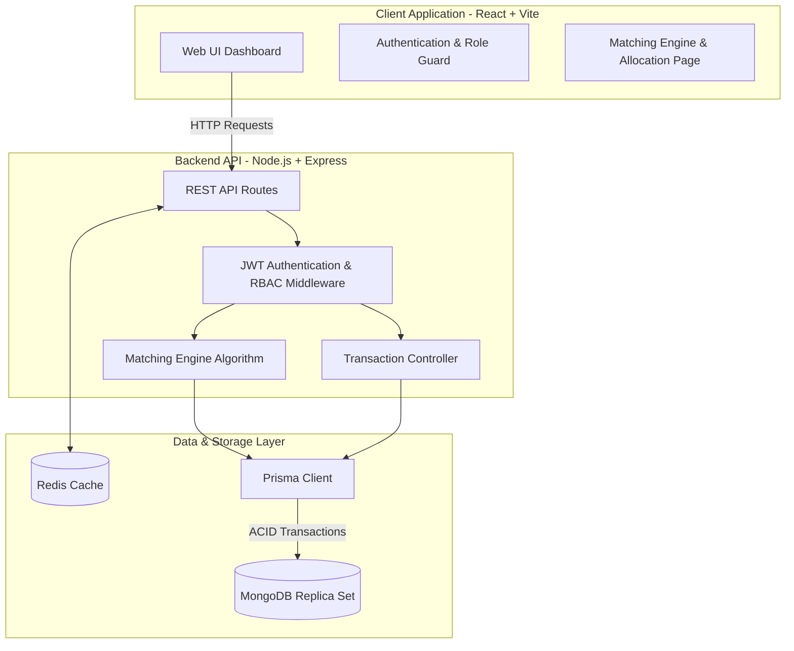

# Organ Transplant Management System (OTMS)
### Complete Project Documentation & Technical Architecture Specification

---

## 1. Executive Summary

The **Organ Transplant Management System (OTMS)** is a comprehensive, production-ready, full-stack medical informatics platform designed to digitize and streamline the organ donation, matching, and allocation lifecycle. 

Organ transplantation is a time-critical domain where minutes determine whether an organ remains viable. Traditional systems often suffer from fragmented record-keeping, slow matching algorithms, and vulnerability to human error. OTMS solves these challenges by combining:
- **Centralized Organ Inventory & Preservation Tracking**: Monitoring retrieval timestamps, maximum ischemic preservation windows, and real-time availability.
- **Intelligent Algorithmic Matching**: Multi-parametric scoring incorporating immunological blood compatibility, urgency levels, and clinical priority.
- **Transaction-Safe Allocation Workflow**: Utilizing database transactions to prevent race conditions, duplicate allocations, or invalid state changes.
- **Role-Based Access Control (RBAC)**: Distinct permissions and views for Administrators, Transplant Doctors, Donors, and Recipients.
- **High-Performance Architecture**: Built with modern web technologies, containerized via Docker, powered by MongoDB with replica-set transaction support, and cached using Redis.

---

## 2. Technical Stack

| Layer | Technology | Details / Purpose |
| :--- | :--- | :--- |
| **Frontend Framework** | React 18, TypeScript | Strongly typed single-page application built for high responsiveness |
| **Frontend Tooling** | Vite | Ultra-fast HMR and optimized production bundling |
| **Styling & UI** | Tailwind CSS, Lucide Icons | Responsive modern interface with curated clinical color palettes and status indicators |
| **Backend Framework** | Node.js (v20), Express.js | High-throughput asynchronous REST API server |
| **Language** | TypeScript | End-to-end type safety across controllers, middleware, and models |
| **ORM / Data Layer** | Prisma ORM (v5) | Type-safe database queries, schema migrations, and relational modeling |
| **Primary Database** | MongoDB 6.0 (Replica Set `rs0`) | Scalable document store running replica set to enable multi-document ACID transactions |
| **Caching & In-Memory** | Redis 7 (Alpine) | Session storage, fast key-value querying, and cache invalidation |
| **Authentication** | JWT (JSON Web Tokens) & bcrypt | Stateless bearer tokens with salted bcrypt password hashing |
| **Containerization** | Docker & Docker Compose | Multi-container microservice orchestration (`server`, `client`, `mongo`, `redis`) |

---

## 3. System Architecture & Workflow



---

## 4. Key Modules & Functional Capabilities

### 4.1. Role-Based Access Control (RBAC)
- **ADMIN**:
  - Full system visibility: organ inventory, transplant waiting list, donor/recipient directories.
  - User management, hospital profile coordination, and audit tracking.
- **DOCTOR**:
  - Can register retrieved organs with specific viability timers.
  - Can review and submit transplant requests for registered patients.
  - Authorizes the Matching Algorithm and triggers the Allocation Workflow.
- **DONOR**:
  - View personal donor profile, registered pledge status, and consent verification.
- **RECIPIENT**:
  - View transplant waiting list status, urgency tier, and allocation alerts.

### 4.2. Organ Inventory & Viability Monitoring
- Supports major organ classifications: `KIDNEY`, `LIVER`, `HEART`, `LUNG`, `PANCREAS`, `CORNEA`.
- Each organ record tracks:
  - Donor reference and harvesting hospital.
  - ABO/Rh blood grouping (`A_POS`, `O_NEG`, `AB_POS`, etc.).
  - Retrieval timestamp and strict expiry countdown.
  - Status lifecycle: `AVAILABLE` &rarr; `MATCHED` &rarr; `ALLOCATED` &rarr; `TRANSPLANTED` / `EXPIRED`.

### 4.3. Recipient Registry & Transplant Requests
- Clinical profiles track patient date of birth, blood group, medical condition, urgency tier (1–10), and medical priority (1–10).
- Transparent waiting list with calculated wait times and status transitions (`PENDING` &rarr; `MATCHED` &rarr; `COMPLETED`).

### 4.4. The Matching Engine
The engine matches available donor organs against pending recipient transplant requests:
1. **Donor Filtering**: Finds all available organs ready for immediate allocation.
2. **Deduplication**: Evaluates candidate recipients at most once per run, selecting their highest-priority request and preventing double records.
3. **Multi-Factor Scoring Formula**:
   $$\text{Compatibility Score} = \text{Blood Score} + \text{Urgency Score} + \text{Medical Priority Score}$$
   - **Blood Compatibility**:
     - *Exact Match*: **50 Points** (e.g., A+ to A+)
     - *Compatible Match*: **35 Points** (e.g., O- universal donor or AB+ universal recipient)
     - *Incompatible / Baseline*: **20 Points**
   - **Urgency Weight**: $\text{Urgency Level } (1\text{–}10) \times 3$ (Up to **30 Points**)
   - **Medical Priority Weight**: $\text{Clinical Priority } (1\text{–}10) \times 2$ (Up to **20 Points**)
4. **Dynamic Output**: Displays candidates with visual score bars, sorted by compatibility score.
5. **UI Status Tabs**: Filter results on the fly across **All**, **Pending**, **Accepted**, and **Rejected** matches.

### 4.5. Atomic Allocation Workflow
When a medical professional authorizes an organ allocation:
1. **Match Status**: The selected match transitions to `ACCEPTED`.
2. **Cascade Rejection**: Competing candidate matches for that same organ automatically transition to `REJECTED`.
3. **Inventory Update**: Organ availability transitions to `ALLOCATED`.
4. **Request & Patient Updates**: Recipient's pending transplant requests transition to `MATCHED` and recipient status changes to `MATCHED`.
5. **ACID Transaction Guarantee**: Executed inside `prisma.$transaction` ensuring that if any single step fails, all operations roll back to prevent half-allocated states.

---

## 5. Database Schema (Prisma / MongoDB)

```prisma
datasource db {
  provider = "mongodb"
  url      = env("DATABASE_URL")
}

generator client {
  provider = "prisma-client-js"
}

enum Role {
  ADMIN
  DOCTOR
  DONOR
  RECIPIENT
}

enum OrganType {
  KIDNEY
  LIVER
  HEART
  LUNG
  PANCREAS
  CORNEA
}

enum BloodGroup {
  A_POS
  A_NEG
  B_POS
  B_NEG
  AB_POS
  AB_NEG
  O_POS
  O_NEG
}

enum OrganStatus {
  AVAILABLE
  MATCHED
  ALLOCATED
  TRANSPLANTED
  EXPIRED
}

enum RequestStatus {
  PENDING
  MATCHED
  REJECTED
  CANCELLED
}

enum MatchStatus {
  PENDING
  ACCEPTED
  REJECTED
}
```

### Core Entities:
- **`User`**: Base identity storing credentials, hashed passwords, roles, and timestamps.
- **`Hospital`**: Medical facilities housing retrieval operations and transplant procedures.
- **`Doctor`**: Clinical specialists linked to a hospital with verification license IDs.
- **`Donor`**: Donors with consent state, blood group, and registered organs.
- **`Recipient`**: Patients awaiting organs with medical metrics, urgency, and priority levels.
- **`Organ`**: Harvested organs with preservation parameters, blood grouping, and hospital location.
- **`TransplantRequest`**: Formal clinical request specifying required organ type and clinical notes.
- **`Match`**: Algorithmic scoring pairings between an organ and a candidate recipient.
- **`Allocation`**: Authorized administrative handoff of an organ to an approved recipient.
- **`Transplant`**: Post-allocation procedural tracking (surgical scheduling, surgeon notes, procedure status).

---

## 6. API Endpoints Specification

### Authentication (`/api/auth`)
| Method | Endpoint | Description | Access |
| :--- | :--- | :--- | :--- |
| `POST` | `/api/auth/register` | Register a new user | Public |
| `POST` | `/api/auth/login` | Authenticate and obtain JWT Bearer token | Public |
| `GET` | `/api/auth/me` | Fetch authenticated user profile & permissions | Authenticated |

### Organ Inventory (`/api/organs`)
| Method | Endpoint | Description | Access |
| :--- | :--- | :--- | :--- |
| `GET` | `/api/organs` | List all registered organs (with donor & hospital) | Authenticated |
| `POST` | `/api/organs` | Register a new donor organ | Doctor / Admin / Donor |
| `PATCH` | `/api/organs/:id/status` | Update organ status (e.g. ALLOCATED, EXPIRED) | Doctor / Admin |

### Matching Engine & Allocation (`/api/matches`)
| Method | Endpoint | Description | Access |
| :--- | :--- | :--- | :--- |
| `GET` | `/api/matches` | Retrieve all match history sorted by score & status | Authenticated |
| `POST` | `/api/matches/run` | Execute algorithmic matching for an organ | Doctor / Admin |
| `POST` | `/api/matches/:id/allocate` | Atomically approve allocation and lock organ | Doctor / Admin |

### Transplant Requests (`/api/requests`)
| Method | Endpoint | Description | Access |
| :--- | :--- | :--- | :--- |
| `GET` | `/api/requests` | List transplant requests on waiting list | Authenticated |
| `POST` | `/api/requests` | File a new transplant request for a recipient | Doctor / Admin |

---

## 7. Installation & Deployment Guide

### Prerequisites
- [Docker](https://www.docker.com/) (version 24.0+)
- [Docker Compose](https://docs.docker.com/compose/) (v2.0+)

### Setup Steps

1. **Clone the repository**:
   ```bash
   git clone <repository-url>
   cd "Organ Transplant Management"
   ```

2. **Configure Environment Variables**:
   Create a root `.env` file (or verify existing settings):
   ```env
   DATABASE_URL="mongodb://mongo:27017/organ_transplant?replicaSet=rs0"
   REDIS_URL="redis://redis:6379"
   PORT=5000
   JWT_SECRET="super_secret_jwt_key_example"
   CLIENT_URL="http://localhost:5173"
   ```

3. **Launch the Containerized Environment**:
   ```bash
   docker compose up -d --build
   ```

4. **Initialize Database & Seed Mock Data**:
   Execute seeding commands within the running server container:
   ```bash
   docker exec otms-server npx prisma db push
   docker exec otms-server npm run seed
   docker exec otms-server npx ts-node prisma/inject-dummy.ts
   ```

5. **Access the System**:
   - **Frontend Application**: `http://localhost:5173`
   - **Backend API Server**: `http://localhost:5000`
   - **MongoDB Replica Set**: `localhost:27017`
   - **Redis Store**: `localhost:6379`

---

## 8. Default Testing Credentials

| Role | Email | Password | Permissions |
| :--- | :--- | :--- | :--- |
| **System Administrator** | `admin@otms.com` | `admin123` | Full access across all modules |
| **Transplant Doctor** | `doctor@otms.com` | `password123` | Matching Engine, Organ Registration, Request Review |
| **Recipient (Patient)** | `george@demo.com` | `password123` | Patient Waiting List View |
| **Recipient (Patient)** | `julia@demo.com` | `password123` | Patient Waiting List View |
| **Donor** | `charlie@demo.com` | `password123` | Donor Profile & Consent View |

> *Tip: The Login page (`/login`) features an interactive 1-click RBAC selector that auto-fills credentials for Doctor, Admin, Recipient, or Donor instantly.*

---

## 9. Security, Privacy & Compliance Architecture

- **HIPAA-Oriented Access Controls**: Personal health information (PHI) and clinical urgency scores are only visible to authorized medical and administrative personnel.
- **Cryptographic Hashing**: All passwords use standard bcrypt with 10 salt rounds.
- **Audit Logging Support**: System state mutations (organ registrations, status overrides, and match allocations) are logged with user identifiers and timestamps.
- **Idempotency & Race Protection**: Prisma transactions ensure atomic operations during allocation, preventing double-allocation of a single organ.
